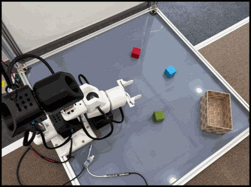
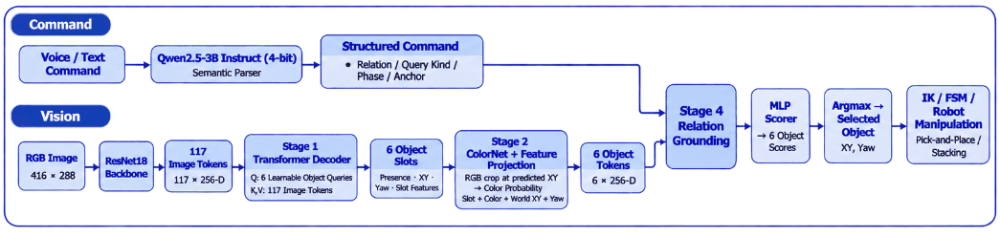
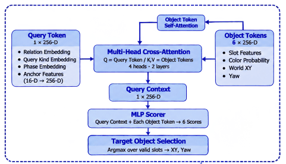
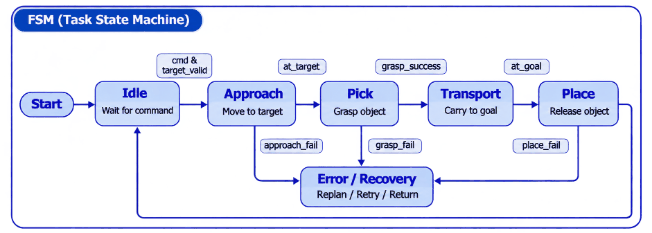
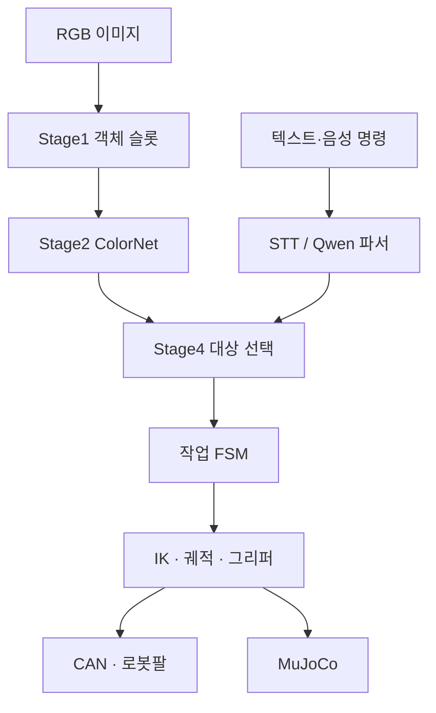

# Object-Centric Vision-Language Manipulation

RGB 이미지와 자연어 명령으로 조작할 객체와 공간 관계를 해석하고, 6-DoF 로봇팔의 pick-and-place 제어로 연결하는 프로젝트입니다. 객체별 시각 표현을 만드는 인식 모델과 ROS 2 기반 FSM·IK·궤적 제어 코드를 함께 구성했습니다.

**Python · C++ · PyTorch · ROS 2 Humble · MuJoCo · Pinocchio · CAN**

[시스템 구성](#시스템-구성) · [코드 구조](#코드-구조) · [실행 방법](#실행-방법) · [상세 실행 안내](docs/QUICKSTART.md)

## 사진 및 시스템 흐름



자체 제작한 6-DoF 로봇팔과 카메라를 사용하는 물체 조작 실험 환경입니다.

### 인식·명령·제어 파이프라인



### 공간 관계 기반 대상 선택



명령에서 구성한 Query와 객체별 Token을 결합해 조작 대상을 선택합니다.

### Pick-and-Place FSM



선택한 객체를 접근·파지·운반·배치 단계로 연결합니다. 그림은 시스템 설계를 설명하며, 실제 비전 입력을 사용하는 전체 시스템의 일반화 성능은 별도 검증이 필요합니다.


## 주요 기능

- **객체 중심 인식**: ResNet18과 Transformer decoder로 객체 슬롯, 존재 여부, 위치, 방향 추정
- **색상·객체 선택**: ColorNet을 이용한 슬롯별 색상 분류와 직접 객체 지정
- **공간 관계 추론**: Stage4 RelationScorer의 cross-attention으로 관계 질의에 해당하는 객체 선택
- **명령 처리**: 텍스트·음성 명령을 STT/Qwen 파서로 작업 표현으로 변환
- **로봇팔 제어**: FSM으로 작업 단계를 관리하고 IK·궤적 생성·그리퍼·CAN 제어로 연결
- **시뮬레이션**: MuJoCo 로봇 모델, pick-and-place 시뮬레이션 및 phase 정책 실험 코드

## 시스템 구성



인지 모듈은 객체 슬롯과 작업 질의를 처리하고, 제어 모듈은 선택된 객체의 월드 좌표를 받아 동작을 수행합니다. 학습·추론은 `src/ml/`, ROS 통합은 `src/demo_supervisor/`, 로봇팔 제어는 `src/phy/`에서 확인할 수 있습니다.

## 코드 구조

| 경로 | 내용 | 먼저 볼 코드 |
|---|---|---|
| [src/ml/stage1](src/ml/stage1/) | 객체 슬롯 인코더·학습 | [model.py](src/ml/stage1/model.py) |
| [src/ml/stage2](src/ml/stage2/) | ColorNet·직접 객체 선택 | [color_net_v2.py](src/ml/stage2/color_net_v2.py) |
| [src/ml/stage4](src/ml/stage4/) | 관계 모델·학습·grounding | [model.py](src/ml/stage4/model.py), [grounding.py](src/ml/stage4/grounding.py) |
| [src/demo_supervisor](src/demo_supervisor/) | 카메라·명령·ML·ROS 통합 | [demo_supervisor_node.py](src/demo_supervisor/demo_supervisor/demo_supervisor_node.py) |
| [src/phy](src/phy/) | 작업 FSM·IK·궤적 실행 | [task_fsm_node.py](src/phy/phy/task_fsm_node.py) |
| [src/idle_launch](src/idle_launch/) | 로봇팔·시뮬레이션 launch | [launch/](src/idle_launch/launch/) |
| [src/sim](src/sim/) | MuJoCo·URDF·메시 | [robot.xml](src/sim/robot.xml) |
| [src/stt](src/stt/) | 음성 인식·자연어 파싱 | [stt.py](src/stt/stt.py) |
| [src/can_interface](src/can_interface/) | CAN 통신 브리지 | [README](src/can_interface/README.md) |
| [param](param/) | 모델·제어 파라미터 | [README](param/README.md) |
| [examples](examples/) | 장비 없이 실행하는 핵심 로직 예제 | [relation_label_demo.py](examples/relation_label_demo.py) |

## 실행 방법

### 1. 장비 없이 관계 라벨 생성 로직 확인

Python 3.10 이상에서 추가 패키지 없이 실행합니다.

```bash
git clone https://github.com/YunBeeeen/idle_ws.git
cd idle_ws
python3 examples/relation_label_demo.py
```

예제 출력은 `leftmost → red_block`, `nearest_to(basket) → blue_block`입니다. 이 예제는 **Stage4 학습 라벨을 생성하는 기하 규칙**을 실행합니다. 학습된 신경망의 관계 추론 코드는 [stage4/model.py](src/ml/stage4/model.py)와 [grounding.py](src/ml/stage4/grounding.py)에 있습니다.

### 2. 모델·학습 환경 준비

```bash
python3 -m pip install -r src/ml/requirements.txt
python3 download_upstream_assets.py --group weights --list
python3 download_upstream_assets.py --group weights
```

가중치 URL과 해시는 [UPSTREAM_ASSETS.json](UPSTREAM_ASSETS.json)에 고정되어 있습니다. 이미지 입력은 학습 데이터의 crop·resize와 카메라 calibration에 맞춰 준비합니다. 학습 명령은 [ML 안내](src/ml/README.md), ROS·카메라 실행 조건과 명령은 [QUICKSTART](docs/QUICKSTART.md)에 정리했습니다.

## 관련 문서

- [로봇팔 시스템 아키텍처](docs/ARCHITECTURE.md)
- [ML 모델·학습](src/ml/README.md)
- [ROS 데모 인터페이스](docs/agent/ros_demo_integration_guide.md)
- [가져온 소스의 출처와 버전](docs/UPSTREAM_INTEGRATION.md)
- [보관된 개발 기록과 별도 데모](docs/ARCHIVE.md)

실기 실행은 ROS 2 Humble, Pinocchio, MuJoCo, SocketCAN 및 해당 모터 구성을 갖춘 환경을 사용합니다. 로봇을 연결하기 전 카메라 좌표계·모터 ID·제어 파라미터를 현재 장치에 맞춥니다.
